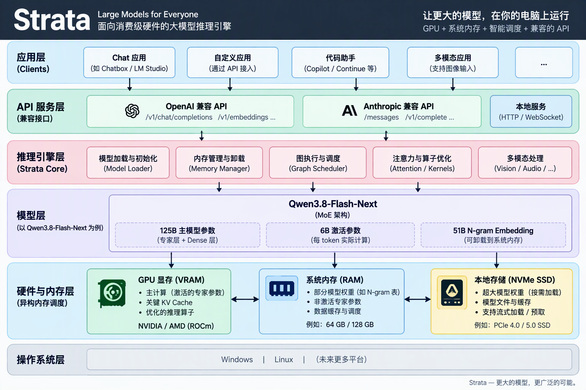

# Strata 单卡 R9700 本地大模型部署与测速实战

> 更新日期：2026-11-03<br>
> 实测日期：2026-11-02<br>
> 实测硬件：AMD Radeon AI PRO R9700 32 GB<br>
> 实测模型：Qwen3.8-Flash-Next Q2_0<br>
> 实测版本：Strata 0.2.9、Terminal/Engine 0.1.55

本文记录一套已经在本地 AMD 工作站上完整跑通的 Strata 单卡部署流程，包括：

- Strata 的定位、组件和常用术语；
- 检查 AMD GPU、内存与磁盘；
- 安装 Strata Terminal；
- 生成单卡部署计划；
- 下载并准备 Qwen3.8-Flash-Next Q2_0；
- 启动本地 Web 与 OpenAI 兼容 API；
- 运行 Strata 标准 benchmark；
- 解读 Prompt、Decode、TTFT 等性能指标；
- 管理服务、排查 GPU 编号、显存不足和下载中断等问题。



*图 1：Strata 分层架构总览。模型权重、活跃专家、缓存和大表可以根据机器条件在 GPU 显存、系统内存与 NVMe 存储之间调度。*

本文所有主要命令均已在以下机器上执行验证。

## 1. 实测结论

### 1.1 硬件与软件

| 项目 | 实测配置 |
| --- | --- |
| GPU | 1 张 AMD Radeon AI PRO R9700 |
| GPU 架构 | `gfx1201` |
| 显存 | 约 32 GB |
| CPU | AMD Ryzen Threadripper PRO 9995WX 96-Cores |
| 系统内存 | 503 GiB |
| 模型盘 | Samsung SSD 9100 PRO 4TB NVMe |
| 操作系统 | Ubuntu 24.04.3 LTS |
| Linux Kernel | `7.0.0-34-generic` |
| ROCm Runtime | benchmark 报告识别为 ROCm 7.2.0 |
| Strata | 0.2.9 |
| Terminal / Engine | 0.1.55 |

### 1.2 模型配置

| 项目 | 实测配置 |
| --- | --- |
| 模型 | Qwen3.8-Flash-Next |
| 量化 | `Q2_0` |
| Context | 32K |
| KV Cache | int8 |
| 并发 | 1 |
| MTP | 开启 |
| 视觉 | 关闭 |
| GPU | 单卡，`--gpu 0` |
| 访问方式 | 本机 `127.0.0.1:8080` |

### 1.3 标准 benchmark 结果

Strata `standard-v1` 在模型加载后用时 1 分 43 秒。协议 ID 为
`strata-qwen38-thinking-v1-draft.1`。21 个必测请求全部完成，没有失败或跳过。

| 场景 | Prompt 吞吐中位数 | Decode 中位数 | TTFT 中位数 | 总耗时中位数 |
| --- | ---: | ---: | ---: | ---: |
| 短提示 | 不作为主要 Prompt 指标 | 109.6 tok/s | 0.36 秒 | 4.7 秒 |
| 4K Prompt | 1823.2 tok/s | 100.3 tok/s | 2.26 秒 | 7.4 秒 |
| 16K Prompt | 2433.1 tok/s | 91.9 tok/s | 6.76 秒 | 12.3 秒 |

三次性能样本范围：

| 场景 | Prompt tok/s | Decode tok/s |
| --- | ---: | ---: |
| 4K Prompt | 1805.1 至 1828.9 | 98.3 至 101.1 |
| 16K Prompt | 2432.1 至 2447.6 | 84.4 至 105.9 |

功能正确性检查：

- 指令遵循：4/4；
- 长文本检索：4/4；
- Tool Call：4/4；
- 合计：12/12。

一句话结论：

> 单张 R9700 运行 Strata Qwen3.8-Flash-Next Q2_0，实测生成速度约 90 至 110 tok/s，4K 至 16K Prompt 读取速度约 1.8K 至 2.4K tok/s。

## 2. Strata 是什么

Strata 是一个面向本地 AI 的开源运行时和应用工具。它将模型服务、硬件探测、模型准备、CPU/GPU 分层、Web 页面以及 OpenAI/Anthropic 兼容 API 整合到一套工作流中。

项目主页：

- <https://github.com/Niko1221/Strata>

Strata 的重点不是简单地把整个模型全部塞入显存，而是根据机器的 GPU、系统内存和存储条件，把不同数据放在合适的位置。

以本次 Qwen3.8-Flash-Next Q2_0 为例：

- 高频专家尽可能放进 GPU 显存；
- 其余专家数据保存在系统内存或模型文件中；
- Prompt 阶段与 Decode 阶段使用不同的批处理和缓存路径；
- MTP 草稿层先预测后续 token，再由主模型验证；
- KV Cache 保存上下文状态；
- PLE 等大表可以放在内存或 NVMe 上。

这种设计让一张 32 GB 显卡也能运行远大于 32 GB 的模型文件。

## 3. Strata 的主要组件

### 3.1 Terminal

`strata` 命令行入口，负责：

- 硬件探测；
- 选择模型和量化；
- 下载与校验组件；
- 生成运行配置；
- 启停服务；
- 查看状态与日志；
- 运行 benchmark。

### 3.2 Engine

真正执行推理的底层程序。Strata 会根据 GPU 下载对应的 Engine。

本次 R9700 使用：

```text
linux-x86_64-hip-rx9070
```

该包覆盖 `gfx1200` 和 `gfx1201`，R9700 属于 `gfx1201`。

### 3.3 Model Pack

Strata 不只保存原始 GGUF，还会针对自己的运行路径准备：

- `experts.bin`；
- `dense.bin`；
- embedding 数据；
- tokenizer；
- 专家索引；
- MTP 运行时文件。

因此，最终磁盘占用通常大于模型的原始下载大小。

### 3.4 Profile

Profile 保存一次启动所需的模型、Context、GPU、端口和其他配置。

本次自动生成的 Profile 名称是：

```text
launch-q2_0-32k
```

### 3.5 Web 与 API 服务

模型启动后默认提供：

```text
Web:        http://127.0.0.1:8080
OpenAI API: http://127.0.0.1:8080/v1
Anthropic:  http://127.0.0.1:8080
```

默认 `local` 访问模式只监听本机，不对局域网或公网开放。

## 4. 常用性能术语

### 4.1 Prompt / Prefill

模型读取输入内容的阶段。

常见指标：

```text
Prompt tokens/s
```

这个指标越高，模型读取长文档、代码仓库或大段上下文所需的时间越短。

长 Prompt 的吞吐可能高于短 Prompt，因为较大的批处理更容易利用 GPU。不能据此理解为“上下文越长模型越快”，实际首 token 等待时间仍会随着输入长度增加。

### 4.2 Decode

模型逐 token 生成答案的阶段。

常见指标：

```text
Decode tokens/s
```

用户平时说的“模型每秒生成多少 token”，通常主要指这个指标。

### 4.3 TTFT

Time To First Token，从请求发出到客户端收到第一个非空生成内容的时间。

TTFT 包括：

- 请求排队；
- Prompt 处理；
- 首次生成准备；
- HTTP 流式传输开销。

长 Prompt 通常会提高 TTFT。

### 4.4 First Answer

启用 Thinking 时，模型可能先输出推理内容，再输出最终回答。

`First Answer` 表示第一次出现最终回答文本或 Tool Call 的时间，不是第一个 Thinking token 的时间。

### 4.5 MTP

Multi-Token Prediction。草稿层一次预测多个候选 token，主模型再进行验证。

MTP 的收益取决于：

- 草稿接受率；
- 模型和量化；
- GPU；
- Prompt 长度；
- 采样参数。

本次启动日志显示 MTP 占用约 839 MiB 显存。关闭 MTP 可以释放部分显存，但通常会降低生成速度。

### 4.6 Expert Cache

Qwen3.8-Flash-Next 是混合专家模型。Strata 会把较常用的专家放入显存缓存。

本次实测：

```text
Expert Cache: 18380 slots
VRAM:         23.66 GiB
```

标准 benchmark 过程中 Decode Expert Cache 命中率大多在 99% 左右。

### 4.7 KV Cache

KV Cache 保存当前会话已处理 token 的注意力状态。

本次使用：

```text
--kv int8
```

Context 越大、并发越高，KV Cache 通常占用越多显存。

### 4.8 Context

模型一次可以保留和处理的上下文长度。

本文选择：

```text
--context 32k
```

不要只追求更大的 Context。更大的 Context 可能增加 KV Cache、显存和首 token 延迟。

## 5. 开始前检查机器

### 5.1 检查 GPU

```bash
rocminfo | grep -E "Marketing Name|Name:"
```

或：

```bash
rocm-smi
```

本次机器识别出四张 R9700，但启动时只选择其中一张。

### 5.2 检查内存

```bash
free -h
```

### 5.3 检查磁盘

```bash
df -h /dc1/kaihui/code
```

本次部署的空间变化：

| 内容 | 大小约 |
| --- | ---: |
| 原始模型下载 | 66.4 GB |
| MTP 下载 | 5.2 GB |
| 总下载 | 71.6 GB |
| 完成模型准备后的数据目录 | 107 GB |
| HIP Engine 压缩包 | 409 MB |
| Terminal 压缩包 | 94 MB |

建议为相同方案预留至少 130 GB 可用空间，避免下载、校验、打包和临时文件把磁盘写满。

不要直接根据本文推断其他模型的空间需求。运行 `--plan` 查看当前版本和所选模型的实际计划。

## 6. 安装 Strata Terminal

### 6.1 官方默认安装

```bash
curl -fsSL \
  https://github.com/Niko1221/Strata/releases/latest/download/install.sh \
  -o /tmp/strata-install.sh

sh /tmp/strata-install.sh
```

默认会把 Terminal 安装到用户目录，并创建：

```text
~/.local/bin/strata
```

如果 `~/.local/bin` 不在 `PATH` 中：

```bash
export PATH="$HOME/.local/bin:$PATH"
```

### 6.2 安装到独立工作目录

本次实测将 Terminal 和模型数据放在工作区，便于管理大文件：

下面的 `/dc1/kaihui/code` 是本次工作站的示例路径。请根据自己的 NVMe、PVC 或数据盘挂载位置替换。

```bash
export STRATA_ROOT=/dc1/kaihui/code/strata-local

mkdir -p "$STRATA_ROOT/bin"

curl -fsSL \
  https://github.com/Niko1221/Strata/releases/latest/download/install.sh \
  -o /tmp/strata-install.sh

STRATA_DATA_DIR="$STRATA_ROOT" \
STRATA_BIN_DIR="$STRATA_ROOT/bin" \
sh /tmp/strata-install.sh
```

后续 Shell 需要设置：

```bash
export STRATA_ROOT=/dc1/kaihui/code/strata-local
export STRATA_DATA_DIR="$STRATA_ROOT"
export PATH="$STRATA_ROOT/bin:$PATH"
```

说明：

- `STRATA_DATA_DIR` 让 Terminal 找到这套独立安装；
- `--data-dir` 决定模型下载位置；
- 部分运行状态、日志或组件仍可能使用用户的 XDG 目录；
- 实际位置以 `strata launch --status` 和启动日志为准。

### 6.3 检查版本

```bash
strata --version
```

本次输出：

```text
strata 0.2.9 (build 0.1.55; python 3.12.15)
```

## 7. 先生成单卡部署计划

不要一上来就开始下载。先用 `--plan` 检查：

- 选中的模型；
- GPU 数量；
- Context；
- 下载体积；
- Engine 是否存在；
- 警告信息。

```bash
export STRATA_ROOT=/dc1/kaihui/code/strata-local
export STRATA_DATA_DIR="$STRATA_ROOT"
export PATH="$STRATA_ROOT/bin:$PATH"

strata launch \
  --family qwen \
  --model q2_0 \
  --data-dir "$STRATA_ROOT/data" \
  --context 32k \
  --gpu 0 \
  --parallel 1 \
  --vision off \
  --tune skip \
  --plan \
  --output json
```

本次计划显示：

```text
模型：Qwen3.8-Flash-Next Q2_0
模型下载：66.4 GB
MTP 下载：5.2 GB
总下载：71.6 GB
GPU：[0]
Context：32768
Parallel：1
Vision：off
```

## 8. 下载、准备并启动模型

### 8.1 一条完整启动命令

```bash
export STRATA_ROOT=/dc1/kaihui/code/strata-local
export STRATA_DATA_DIR="$STRATA_ROOT"
export PATH="$STRATA_ROOT/bin:$PATH"

strata launch \
  --family qwen \
  --model q2_0 \
  --data-dir "$STRATA_ROOT/data" \
  --context 32k \
  --gpu 0 \
  --parallel 1 \
  --vision off \
  --tune skip \
  --yes \
  --no-tui
```

第一次执行会依次完成：

1. 检查 GPU 和 Engine；
2. 下载并验证 HIP Engine；
3. 下载 GGUF 分片；
4. 计算 SHA-256；
5. 打包专家数据；
6. 创建专家索引；
7. 准备 tokenizer；
8. 下载并准备 MTP；
9. 写入运行配置；
10. 加载模型并启动本地服务。

下载或准备过程被中断后，可以原样重新执行同一条命令。Strata 会复用已完成步骤并继续下载。

### 8.2 本次首次准备过程

本次关键阶段：

```text
Terminal 下载：94 MB
HIP Engine 下载：409 MB
模型下载：66.4 GB
MTP 下载：5.2 GB
专家打包：约 1 至 2 分钟
模型冷启动加载：约 22 秒
```

下载时间主要取决于网络和镜像速度，模型打包与加载时间取决于 CPU、内存和存储。

### 8.3 启动成功标志

```text
The model is loaded and answering.
Ready: http://127.0.0.1:8080
Strata is serving.
```

浏览器打开：

```text
http://127.0.0.1:8080
```

## 9. 验证服务

### 9.1 查看状态

```bash
strata launch --status
```

### 9.2 健康检查

```bash
curl -fsS http://127.0.0.1:8080/health
```

本次返回：

```json
{
  "status": "ok",
  "max_context": 32768,
  "model": "qwen3.8-flash-next-q2_0",
  "images": false,
  "api_key": false,
  "loaded": true,
  "service": "strata"
}
```

### 9.3 查询模型

```bash
curl -fsS http://127.0.0.1:8080/v1/models
```

### 9.4 发送 OpenAI 兼容请求

```bash
curl -fsS http://127.0.0.1:8080/v1/chat/completions \
  -H "Content-Type: application/json" \
  -d '{
    "model": "qwen3.8-flash-next-q2_0",
    "messages": [
      {
        "role": "user",
        "content": "请用三点介绍 AMD ROCm。"
      }
    ],
    "temperature": 0.7,
    "top_p": 0.8,
    "max_tokens": 512,
    "chat_template_kwargs": {
      "enable_thinking": false
    }
  }'
```

## 10. 确认只使用一张 GPU

启动日志会显示 Main 和 Off 卡，例如：

```text
Main: GPU 1 RX 9070 series / AI PRO R9700
Off: GPU 2 ...
Off: GPU 3 ...
Off: GPU 4 ...
```

还可以检查 KFD 进程：

```bash
rocm-smi --showpids
```

本次 Strata Engine 进程只占用一张 GPU：

```text
PROCESS NAME: strata-host
VRAM USED:   约 31.3 GB
```

注意 GPU 编号可能来自不同枚举方式：

- `strata launch --gpu 0` 使用 Strata 的 0-based 编号；
- 启动界面可能显示 GPU 1；
- `rocm-smi` 的 Device 编号可能按 PCIe/KFD 顺序排列；
- 不要只看一个编号判断是不是同一张卡；
- 应同时核对卡名、进程、显存占用和启动日志。

本次模型加载完成后，Engine 日志显示：

```text
Expert Cache: 23.66 GiB
MTP:          839 MiB
VRAM Free:    约 608 至 624 MiB
```

这是一套接近占满 32 GB 显存的配置。

## 11. 运行标准 benchmark

### 11.1 测试前准备

确认没有其他推理任务占用相同 GPU：

```bash
rocm-smi --showpids
```

检查服务：

```bash
strata launch --status
curl -fsS http://127.0.0.1:8080/health
```

### 11.2 执行 benchmark

```bash
mkdir -p /dc1/kaihui/code/strata-bench-single-r9700

strata bench run \
  --profile launch-q2_0-32k \
  --no-start \
  --track default \
  --track-notes "Strata 0.2.9, Terminal 0.1.55, single GPU 0, 32K context, parallel 1, vision off" \
  --quantization Q2_0 \
  --out /dc1/kaihui/code/strata-bench-single-r9700
```

如果不知道 Profile 名称：

```bash
strata launch --status --output json
```

也可以直接测试正在运行的地址：

```bash
strata bench run \
  --url http://127.0.0.1:8080 \
  --track default \
  --track-notes "single R9700, Q2_0, 32K" \
  --quantization Q2_0 \
  --out ./strata-bench-single-r9700
```

### 11.3 标准测试做了什么

本次标准测试包括：

- 1 个 warm-up 请求，不计入性能汇总；
- 短 Prompt、4K Prompt、16K Prompt 各 3 次；
- 4 个精确指令检查；
- 4 个长文本检索检查；
- 4 个 Tool Call 检查。

性能请求启用：

```text
Thinking: xhigh
Temperature: 1.0
Top P: 0.95
Top K: 20
```

测试结果目录包含：

```text
README.md
results.json
outputs.jsonl
config.json
provenance/
```

其中：

- `README.md`：适合人类阅读的汇总；
- `results.json`：结构化结果；
- `outputs.jsonl`：每个请求的原始输出、usage 和 timings；
- `config.json`：运行配置；
- `provenance/`：模板和 benchmark 语料来源信息。

### 11.4 Benchmark 注意事项

Strata 当前将该标准协议标为 draft。结果可以复现和比较，但分享时应同时保留：

- Strata 和 Engine 版本；
- 模型与量化；
- Context；
- GPU 数量；
- MTP、KV Cache 和 Expert Cache 配置；
- Prompt 长度；
- 是否有后台负载；
- 测试协议 ID。

本次部分性能请求达到 512 token 上限，被报告为 `truncated`。这不代表 Engine 出错，而是请求在仍输出 Thinking/Answer 时达到 benchmark 的固定上限。

## 12. 查看日志与实时监控

### 12.1 查看 Engine 日志

```bash
strata logs --follow
```

或查看启动时打印的日志路径。

日志中的速度行类似：

```text
strata serve: prompt 4093 tokens = 0 reused + 4093 read in 2245 ms
              (1823.2 tok/s), 512 generated in 5105 ms
              (100.3 tok/s)
```

含义：

- `reused`：从 Prompt Cache 复用的 token；
- `read`：本次真正处理的 Prompt token；
- `generated`：Engine 实际生成的 token；
- 第一个 tok/s：Prompt 吞吐；
- 第二个 tok/s：Decode 吞吐。

### 12.2 打开 Monitor

```bash
strata monitor --url http://127.0.0.1:8080
```

### 12.3 查看 AMD GPU

```bash
watch -n 1 rocm-smi
```

或：

```bash
rocm-smi --showmemuse --showuse --showpower --showtemp
```

## 13. 停止与重新启动

### 13.1 停止服务

```bash
strata launch --stop
```

验证：

```bash
strata launch --status --output json
rocm-smi --showpids
```

### 13.2 重新启动

模型和 Pack 已准备好后，再次执行原启动命令即可：

```bash
export STRATA_ROOT=/dc1/kaihui/code/strata-local
export STRATA_DATA_DIR="$STRATA_ROOT"
export PATH="$STRATA_ROOT/bin:$PATH"

strata launch \
  --family qwen \
  --model q2_0 \
  --data-dir "$STRATA_ROOT/data" \
  --context 32k \
  --gpu 0 \
  --parallel 1 \
  --vision off \
  --tune skip \
  --yes \
  --no-tui
```

本次已准备模型的冷启动加载时间约 22 秒，不需要重新下载和打包。

## 14. 目录结构

本次主要目录：

```text
/dc1/kaihui/code/strata-local/
├── bin/
│   └── strata
├── terminal/
└── data/
    ├── models/
    │   └── Q2_0/
    ├── packs/
    │   └── q2_0/
    └── mtp/
        └── rt/
```

主要大文件：

```text
models/Q2_0/Qwen3.8-Flash-Next-GSQ-RCO-Q2_0-00001-of-00002.gguf
models/Q2_0/Qwen3.8-Flash-Next-GSQ-RCO-Q2_0-00002-of-00002.gguf
packs/q2_0/experts.bin
packs/q2_0/dense.bin
mtp/mtp-q2_0.gguf
mtp/rt/experts.bin
```

不要只保留 GGUF 后删除 Pack。Pack 是 Strata 启动该模型需要的准备结果。

## 15. 常见问题

### 15.1 `Read-only file system` 或找不到 install 目录

如果使用独立安装目录，必须在每个新 Shell 中设置：

```bash
export STRATA_ROOT=/dc1/kaihui/code/strata-local
export STRATA_DATA_DIR="$STRATA_ROOT"
export PATH="$STRATA_ROOT/bin:$PATH"
```

然后再运行 `strata`。

### 15.2 模型下载中断

原样重新执行启动命令。Strata 会继续未完成下载，并复用通过校验的文件。

不要手工把不完整文件改名成最终 GGUF。

### 15.3 端口 8080 被占用

查看：

```bash
ss -ltnp | grep ':8080'
```

改用其他端口：

```bash
strata launch \
  --family qwen \
  --model q2_0 \
  --data-dir "$STRATA_ROOT/data" \
  --context 32k \
  --gpu 0 \
  --parallel 1 \
  --vision off \
  --port 8081 \
  --yes \
  --no-tui
```

### 15.4 显存不足

这套单卡配置已经接近占满 32 GB 显存。可以依次尝试：

1. 确认没有其他进程占用该卡；
2. 保持 `--parallel 1`；
3. 保持 `--vision off`；
4. 降低 Context；
5. 添加 `--mtp off`，释放部分显存，但生成速度会下降；
6. 重新运行 `--plan`，检查当前版本给出的模型和显存建议。

### 15.5 `--gpu 0` 与 `rocm-smi` 显示的卡号不同

这是枚举顺序差异，不一定是多卡误用。核对：

```bash
rocm-smi --showpids
strata launch --status
strata logs --follow
```

确认只有一个 `strata-host` 进程占用一张卡即可。

### 15.6 Benchmark 结果波动

测试前关闭或等待以下任务结束：

- 其他大模型推理；
- `llama-bench`；
- GPU 视频生成；
- 大规模磁盘读写；
- 模型下载或哈希；
- CPU 满载任务。

建议至少运行三次样本，并同时报告中位数和范围。

### 15.7 是否可以开放到局域网或公网

本文只使用：

```text
--access local
```

如果改为 LAN 或公网访问，应设置 API Key，不要直接暴露无鉴权接口。先查看：

```bash
strata launch --help
```

## 16. 单卡与多卡怎么选

对于能在单张卡上获得足够 Expert Cache 命中率的模型，单卡通常更简单：

- 不需要跨卡拆层；
- 没有额外跨卡同步；
- 配置和排错更容易；
- 不占用其他 GPU；
- 更适合作为稳定基线。

多卡可能适合：

- 单卡无法容纳必要的稠密权重或缓存；
- 更大模型或更高量化；
- 更大 Context；
- 需要测试层拆分或 Main/Helper 角色；
- 有明确的多卡性能收益。

多卡不一定自动更快。跨卡传输、层拆分、CPU/GPU 协作和缓存命中都可能影响 Decode。

建议先完成单卡基线，再测试多卡方案。

## 17. 本次验证中的关键观察

1. 单卡启动配置生效，另外三张 R9700 被标记为 Off。
2. Q2_0 原始下载约 66.4 GB，MTP 约 5.2 GB。
3. 完成专家 Pack 和 MTP 准备后，数据目录约 107 GB。
4. 模型加载约 22 秒。
5. 单卡显存占用约 31.3 GB，剩余空间较少。
6. 4K Prompt 三次吞吐波动约 1.3%。
7. 16K Prompt 三次吞吐波动小于 1%。
8. Decode 会受到 MTP 接受率和生成内容影响，16K 三次结果为 84.4 至 105.9 tok/s。
9. 12 个正确性检查全部通过。
10. 测试结束后 `strata launch --stop` 可以正常释放 GPU。

## 18. 参考资料

- Strata 项目：<https://github.com/Niko1221/Strata>
- Strata AMD HIP 指南：<https://github.com/Niko1221/Strata/blob/main/docs/AMD_HIP.md>
- Strata 模型说明：<https://github.com/Niko1221/Strata/blob/main/docs/MODELS.md>
- Strata benchmark 协议：<https://github.com/Niko1221/Strata/blob/main/docs/BENCHMARK_PROTOCOL.md>
- Strata Terminal 指南：<https://github.com/Niko1221/Strata/blob/main/docs/TERMINAL_LAUNCH.md>
- Strata 故障排查：<https://github.com/Niko1221/Strata/blob/main/docs/TROUBLESHOOTING.md>

## 19. 免责声明

本文记录的是特定日期、特定版本和特定机器上的实测结果。Strata、模型文件、Engine、ROCm 和驱动仍在持续更新。

复现时请优先查看：

```bash
strata --version
strata launch --help
strata launch --plan ...
```

不要把本文的下载大小、显存占用或速度直接套用到其他模型、量化、GPU、Context 或多卡配置。
